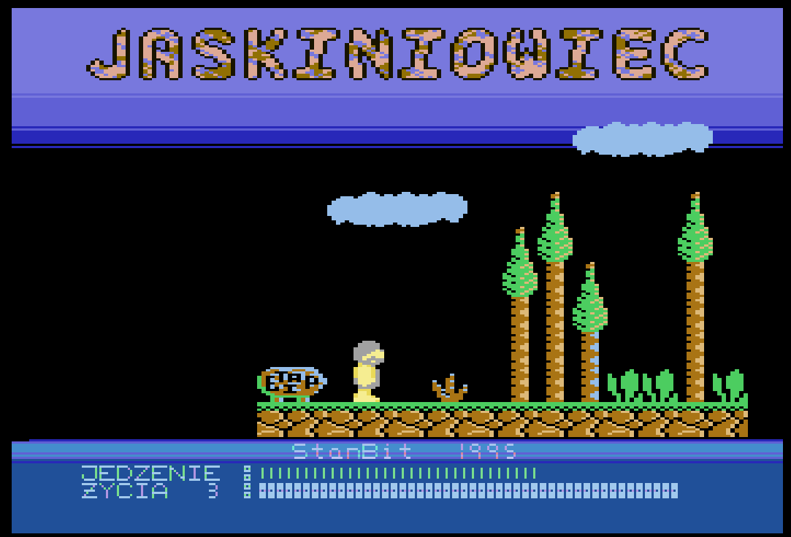
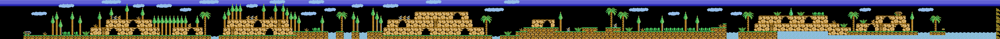
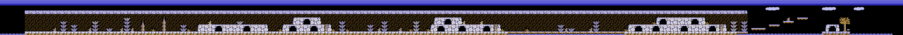
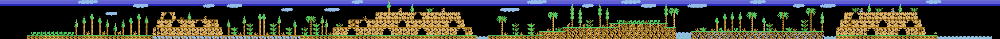
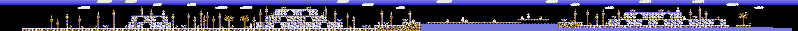
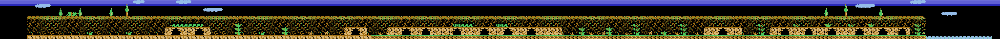
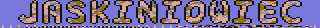

# Jaskiniowiec (1995, StanBit) – XEX reverse engineering



*Start screen, running in the XFormer emulator – the reference used to verify the renders (NOTES.md section 13).*

Analysis of `Jaskiniowiec (1995)(StanBit)(PL)[h CAMOsoft][t +1 CAMOsoft].xex`
(original location: `x:\ATARI\GryKamil\`, 35,286 bytes). The regenerate steps expect it in `bin/`; it is
**not tracked in git** (the root `.gitignore` rule `*.XEX` also matches `.xex`), so put it there yourself.
Everything after `game.bin` (sources, build, level pictures) works without it.

Goal: unpack the cracked XEX, get the real game code into memory and disassemble it,
then (later) annotate it the same way as Dangerous City's `DC.ASM`.

## Files in this folder

| File | Purpose |
|---|---|
| [NOTES.md](NOTES.md) | How the analysis was done, findings, lessons, open questions |
| `main.asm` | MADS file linking all blocks from `src/` back into the game memory image |
| `src/` | The game split into blocks (see [Source blocks](#source-blocks)) |
| `game.bin` | 64 KB memory image as it is when the game starts (after loader, depacker and snapshot restore) |
| [util/xex.py](util/xex.py) | XEX segment parser + linear 6502 disassembler + Atari OS/hardware label table |
| [util/emu.py](util/emu.py) | Minimal 6502 emulator that runs the XEX load sequence (INITAD/RUNAD) and dumps memory at a stop address |
| [util/resume.py](util/resume.py) | Continues from `mem.bin` at $0480 (snapshot restore) until `RTI`, prints the resume PC, writes `game.bin` |
| [util/rdis.py](util/rdis.py) | Recursive-descent disassembler (follows JMP/JSR/branches and DLI/VBI vector setups) → MADS-style listing |
| [util/split.py](util/split.py) | Splits `game.bin` into the blocks of `src/` (block table `BLOCKS` at the top) and writes `main.asm` |
| [util/asm.py](util/asm.py) | Minimal assembler for the MADS subset `split.py` writes – checks the split without MADS |
| [util/verify.py](util/verify.py) | Compares an assembled segment file with `game.bin` byte for byte |
| [util/levels.py](util/levels.py) | Renders the 6 level maps and the title logo to PNG ([img/levels/](img/levels/)) |
| `Makefile` | `make` builds `bin/game.obx` with MADS, `make test` verifies it |

## Source blocks

Like [Misja](../misja) and [Digi Duck](../digi-duck): code areas are disassembled to `.ASM` files,
data areas are binary files with an Atari `$FFFF` header (included with `OPT h-` / `INS`).
Names are by address where the content is not understood yet – rename them in `BLOCKS` in `util/split.py`.

Code:

| File | Address | Content |
|---|---|---|
| [src/JOINT.ASM](src/JOINT.ASM) | – | common labels (Atari OS/hardware, labels outside the blocks) |
| [src/TRAINER.ASM](src/TRAINER.ASM) | $6200-$646F | CAMOsoft crack stub and trainer (written over level 2 map rows 0-2) |
| [src/SPRITE.ASM](src/SPRITE.ASM) | $7C00-$8873 | software sprite engine: draws enemies into characters, double-buffered screen/font/display list (`$882C` swaps them every frame) |
| [src/DLI.ASM](src/DLI.ASM) | $8874-$8A4C | DLI chain ($8874 → $88AA → $8929, colours per row, status line font $6C), display lists $8974 / $89D8 |
| [src/PLAYER.ASM](src/PLAYER.ASM) | $8A4D-$8DEF | player control, run as deferred VBI ($8A8F, VVBLKD set by the init table); OPTION = music on/off ($8A64); clears players $CC00-$CFFF ($8A4D) |
| [src/MAIN.ASM](src/MAIN.ASM) | $8DF0-$9026 | tile attribute lookup ($8DF0), status line ($8DF8), game entry ($8E67), main loop ($8EC3), sound effects ($8F08), screen flip left/right ($8F4C/$8F82), map drawing ($8FC7) |
| [src/ENEMY.ASM](src/ENEMY.ASM) | $9027-$9214 | 4 enemies: walkers / flyers / vertical ($9027), spawning per screen ($9151) |
| [src/INIT.ASM](src/INIT.ASM) | $9215-$948E | font copy ($9215), init poke tables ($927D/$92EC), game variables $9349-$93C6, table builder ($93C7, not called) |
| [src/ROOMS.ASM](src/ROOMS.ASM) | $948F-$96C7 | player map probe ($948F), cave rooms: own loop ($94F7) and set-up |
| [src/FADE.ASM](src/FADE.ASM) | $96C8-$9795 | colour fade out/in |
| [src/ITEMS.ASM](src/ITEMS.ASM) | $9796-$99FF | enemy/hazard contact, energy $A5 and lives $A7 ($9802), treasures: draw ($9837), pick up ($99E4, `$A6`) |
| [src/LEVEL.ASM](src/LEVEL.ASM) | $9A00-$9E96 | 6 level loaders ($9A00…$9B2D), text screens ($9B55 intro, $9B72 next level, $9B8F game over, $9BAF victory), scroller ($9CFB), level completion ($9D6D) |
| [src/IRQ.ASM](src/IRQ.ASM) | $9E97-$9FDA | music init, NMI ($9EAE), IRQ ($9EC8), VBI ($9ED6) with keyboard cheat |
| [src/ENDING.ASM](src/ENDING.ASM) | $AB7D-$B4ED | ending sequence ($AEF0) with its DLI ($ABDA) and display list ($ACFC) |
| [src/SCREEN.ASM](src/SCREEN.ASM) | $BC00-$BFFF | playfield screen memory (2 buffers); holds the crack start stub at $BC00 until the first draw |
| [src/CMC.ASM](src/CMC.ASM) | $F2E1-$FAD1 | CMC music player |
| [src/VECTORS.ASM](src/VECTORS.ASM) | $FFFA-$FFFF | NMI, RESET, IRQ vectors |

Data:

| File | Address | Content |
|---|---|---|
| [src/SYSTEM.DTA](src/SYSTEM.DTA) | $0000-$04FF | zero page, stack, OS variables at snapshot time |
| [src/D0500.DTA](src/D0500.DTA) | $0500-$07FF | unknown (loader leftovers?) |
| [src/FONT08.FNT](src/FONT08.FNT) | $0800-$0FFF | level font A (copied to $D800/$E000 by $9221) |
| [src/FONT10.FNT](src/FONT10.FNT) | $1000-$17FF | level font B ($9239) |
| [src/FONT18.FNT](src/FONT18.FNT) | $1800-$1FFF | text screens font ($9215) |
| [src/SHAPES.DTA](src/SHAPES.DTA) | $2000-$27FF | sprite shapes, 64 frames × 32 bytes (pointers at $C800/$C840) |
| [src/D2800.DTA](src/D2800.DTA) | $2800-$2FFF | unknown; $2C00-$2EFF is the ending work area |
| [src/MAP30.DTA](src/MAP30.DTA) | $3000-$39FF | level 1 map (10 rows × 256 tiles) |
| [src/MAP3A.DTA](src/MAP3A.DTA) | $3A00-$43FF | level 3 map |
| [src/MAP44.DTA](src/MAP44.DTA) | $4400-$4DFF | level 5 map |
| [src/MAP4E.DTA](src/MAP4E.DTA) | $4E00-$57FF | level 4 map |
| [src/MAP58.DTA](src/MAP58.DTA) | $5800-$61FF | level 6 map |
| [src/MAP62.DTA](src/MAP62.DTA) | $6470-$6BFF | level 2 map (rest, see TRAINER.ASM) |
| [src/FONT6C.FNT](src/FONT6C.FNT) | $6C00-$6FFF | status line font |
| [src/TILES.DTA](src/TILES.DTA) | $7000-$70FF | tile attributes (solid, hazard, exit, treasure bits) |
| [src/PICTURE.DTA](src/PICTURE.DTA) | $7100-$7BFF | title logo "JASKINIOWIEC" (mode E, 40 bytes per line; colours $10/$24/$3A on $76) above the playfield |
| [src/TEXTS.DTA](src/TEXTS.DTA) | $9FDB-$A4E8 | cave room screen ($9FE3), status line ($A0AB, "JEDZENIE", "ZYCIA"), text pages and scroller ($A1A1) |
| [src/LEVELDAT.DTA](src/LEVELDAT.DTA) | $A4E9-$AB7C | per-level tables: treasures ($A4E9), enemies per screen ($A4FD/$A50A), enemy sets ($A517…), cave rooms ($A9F7…) |
| [src/MUSCOPY.DTA](src/MUSCOPY.DTA) | $B4EE-$BBFF | unused copy of `MUSIC.CMC` with XEX header (loader leftover) |
| [src/TABLES.DTA](src/TABLES.DTA) | $C000-$C9FF | bit reverse $C000, pixel mirror $C100, masks $C200, current level enemies $C500 / cave rooms $C600, shape pointers $C800 |
| [src/MUSIC.CMC](src/MUSIC.CMC) | $EA00-$F2E0 | CMC music module |

## Level maps

Rendered from `game.bin` by `py -3 util/levels.py game.bin img/levels` (XFormer palette, verified against
[img/jaskiniowiec.png](img/jaskiniowiec.png)). Each map is 256 tiles wide = 12.8 screens; enemies, treasures
and the player are not part of the maps. Level 2's top rows ($6200-$646F) are shown blank, as in the game –
the original tiles there were overwritten by the crack's trainer.

| Level | Map | Font | Image |
|---|---|---|---|
| 1 | $3000 | A |  |
| 2 | $6200 | B |  |
| 3 | $3A00 | A |  |
| 4 | $4E00 | B |  |
| 5 | $4400 | A |  |
| 6 | $5800 | B |  |

Title logo (`PICTURE.DTA`): 

## Game structure

- **Start**: `$8E67` sets up memory (OS off), runs the init tables (VDSLST=$8874, SDLSTL=$8974, VVBLKD=$8A8F,
  PMBASE=$C8, lives $A7=3, energy $A5=$60), loads level 1 and shows the intro text screen.
- **Main loop** `$8EC3`, every 3 frames: enemies (`$9027`, then sprite drawing and buffer swap), sound effects,
  player map probe, enemy contact, status line, cave room check (`$94F7`), level completion (`$9D6D`).
  Player X `$934D` beyond $9C / below 4 scrolls the map by one screen (`$935A`).
- **Player** moves in the deferred VBI (`$8A8F`) and is drawn with P/M graphics ($CC00-$CFFF).
- **Levels**: 6, order by `$935C`: map $3000, $6200, $3A00, $4E00, $4400, $5800. A level ends on an exit tile
  with 32 treasures (`$A6`=$20); after level 6 comes the ending (`$AEF0`).
- **Cheat**: typing `PIERWSZY` (shifted keys, table $9F75) sets lives to 8.
- **Protection leftovers**: checks of $D20D / $C001 / $C002 in the VBI and `$9A28` are NOPed by the crack;
  `$8820` overwrites the sprite routine at $84E9 when `$DF` bit 7 is clear.

$CA00-$FFF9 outside the blocks and the I/O area $D000-$D7FF are zero in `game.bin`.
`main.asm` produces a segment file equal to `game.bin`, not a runnable executable
(segments under the OS ROM need a loader – see next steps).

## How to regenerate

Requires Python 3 (`py -3`) and the `MADS` environment variable (see "MADS location" in the
[root README](../README.md)). The scripts live in `util/` but are run **from this folder**: data paths
(`game.bin`, `mem.bin`, `src/`, `main.asm`, `bin/`) are relative to it. In PowerShell:

```powershell
py -3 util/xex.py "bin\Jaskiniowiec (1995)(StanBit)(PL)[h CAMOsoft][t +1 CAMOsoft].xex"
py -3 util/emu.py "bin\Jaskiniowiec (1995)(StanBit)(PL)[h CAMOsoft][t +1 CAMOsoft].xex" 0480 mem.bin
py -3 util/resume.py
py -3 util/split.py game.bin 6214 9EAE 9EC8 9ED6 62DF 9E97 F2E1 F2E4 F2E7 8A8F 8874 88AA 8929 93C7
& $env:MADS main.asm -o:bin/game.obx
py -3 util/verify.py bin/game.obx
```

From Git Bash the assembler line is `"$MADS" main.asm -o:bin/game.obx`.

1. `xex.py` – lists segments.
2. `emu.py` – loads all segments, runs INIT/RUN vectors, stops when PC reaches $0480 → `mem.bin`.
3. `resume.py` – runs the snapshot restore → reports `resume PC=$6200` → `game.bin`.
4. `split.py` – writes `src/*` and `main.asm`. Arguments after `game.bin` are entry points.
5. MADS + `verify.py` – reassemble and check the result equals `game.bin` (verified with MADS 2.1.5).
   Without MADS, `py -3 util/asm.py main.asm bin/game.obx` builds the same image.

`py -3 util/rdis.py game.bin 0000-FFFF <entries>` still writes the whole image as one listing (`0000_FFFF.asm`).

## XEX structure (22 segments)

| # | Address | Content |
|---|---|---|
| 0–1 | $0C00-$0CF5, INIT $0C03 | CAMOsoft intro, XOR `$A2`-encrypted (bytes $0C1E-$0CF5). Text: "JASKINIOWIEC / press START / File version by CAMOsoft / Copyright (C) 1995 by StanBit" |
| 2–3 | $28A0, INIT $28A0 | Saves RUNAD to $27FE |
| 4 | $2800-$2894 | RLE unpacker (header at $3000: dest start, dest end) |
| 5 | $3000-$4384 | Packed loading-screen data |
| 6–7 | $28A0, RUNAD $28A0 | Restores RUNAD, unpacks loading screen (`JSR $2800`), `JSR $2710`, then `JMP $0500` |
| 8 | $0500-$0535 | Block copier: $6400 → (patched target), with OS ROM off (PORTB=$FE) |
| 9–11 | $6400-$77FF + patch $0514, INIT $0500 | 5 KB → **$EC00** (RAM under OS) |
| 12–14 | same | 5 KB → **$D800** |
| 15 | $022F | SDMCTL |
| 16–18 | same | 5 KB → **$BC00** |
| 19 | $85D6-$BBFF | Main game, **packed** (13,866 bytes) |
| 20 | $0500-$06B1 | Depacker: relocates itself to $0700/$0800 and zero page, OS off, unpacks backwards (skips I/O $D000-$D7FF), ends with `JMP $0480` |
| 21 | $02E0-$02E3 | RUNAD $0500, INITAD $0C00 (shows the intro first) |

## Boot chain

1. **$0C00** – intro, waits for START, `JMP $28A0` → loading screen → `JMP $0500` (depacker).
2. **$0480** – **memory-snapshot restore** (this is the `[h]` = hacked/frozen version):
   restores zero page from $0C80, stack from $1400, $1000 → zero page, GTIA/POKEY/PIA registers,
   moves some pages via a stub copied onto the stack, then `RTI`.
   The `NOP NOP` at $0495 is a patched-out START wait.
3. **$6200** – crack stub: sets DOSINI ($02/$03) = $6214, `BOOT?`=2, `JMP WARMSV`.
4. **$6214** – **CAMOsoft trainer** (`[t +1]`): fading text from $6418
   **"Unlimited lives ?  [Y/N]"**. Keys checked: KBCODE $2B (**Y**) and $2D (**T** = "Tak").
   On yes it calls the patch from the table at $63C2 → **$6376**:
   ```
   6376  LDA #$EA        ; NOP
         STA $8C4E/$8C4F ; removes DEC $A7
         STA $982D/$982E ; removes DEC $A7
   ```
   → **lives counter = zero page `$A7`**.
5. **$BC00** – clears trainer memory $6200-$646F, `JMP $8E67`.
6. **$8E67** – **real game entry** (start annotating here).

## Known addresses in the game

| Address | Meaning |
|---|---|
| $8E67 | Game entry |
| $A7 (ZP) | Lives counter (decremented at $8C4E and $982D) |
| $9EAE | Own NMI handler (OS ROM off): DLI → `JMP (VDSLST)`, else VBI |
| $9EC8 | Own IRQ handler (just disables IRQEN) |
| $9ED6 | VBI routine (sets PORTB=$FF …) |
| $9E97 | Music re-init (`JSR $8FBF`, CMC init) |
| $F2E1 | **CMC music player** (same convention as Dangerous City `rep`): `LDA #$70 / LDX #<tune / LDY #>tune / JSR $F2E4`; `+6` = play |
| $EA00 | Music data (tune passed in X/Y = $00/$EA) |
| `A=$21, X=$18, Y=$14, JSR $F2E4` | Sound effect, e.g. on life lost ($8C50, $9822) |
| $3000-$6BFF | Level maps, 6 × $A00: 10 rows × 256 tiles, one tile = 2 characters (drawn by $8FC7) |
| CHBAS $E0 | Set by the trainer ($6234) – OS ROM font; RAM under the OS at $E000 is empty |
| $6C00 | Status line font (set by the DLI at $88C4) |
| $D800 / $E000 | Level font, double-buffered with the screens $BC00 / $BE00 (`$83` = current font page) |
| $934D / $934E | Player X / Y |
| $9357 | Tiles under the player: bit 3 hazard, bit 4 exit, bit 5 treasure (`$948F`) |
| $935A / $935C | Map column of the current screen / level number |
| $A5 / $A6 | Energy (starts $60) / treasures collected (32 needed) |
| $7C60/$7C64/$7C68/$7C6C | Enemy X / Y / flags / frame (4 each); type $93BF, speed $93B0 |
| $ACFC | Display list (set at $AC18, $B25C); SDLSTL=$BDEF in the snapshot is not a real display list |

`rdis.py` with the entry points above finds ≈10.7 KB of code (476 labels). The player code ($8A8F),
DLIs ($8874, $88AA, $8929) and the table builder ($93C7) are only reached through data (init table, VDSLST),
so they are listed as entry points explicitly.

## Limitations

- This is a **disassembly**, not a high-level decompilation; turning it into readable logic is manual work.
- Code reached only via jump tables or `JMP (ind)` is not discovered and shows as `dta` – add entry
  points to the `rdis.py` command line when you find them.
- The emulator stubs hardware: `$14` increments on every read, CONSOL alternates 6/7, VCOUNT/RANDOM fake,
  `$D000-$D7FF` reads 0 / writes ignored, RAM under OS treated as flat memory, OS ROM calls (when PORTB bit 0 = 1)
  are skipped as `RTS`. Good enough for the loader; not for running gameplay.
- In-game texts are probably in the custom font, so the text scan found only tile maps.

## Next steps (ideas)

- Annotate the modules (like `DC.ASM`): replace `Lxxxx` / `$93xx` with names, starting with `PLAYER.ASM` and `MAIN.ASM`.
- Draw enemies, treasures and cave-room entrances (`LEVELDAT.DTA`) onto the level maps.
- Identify `D0500.DTA` and `D2800.DTA`.
- Level 2 map rows 0-2 ($6200-$646F) are cleared after the trainer – the original tiles there are lost in this
  version (other maps have 10-40 tiles in these rows); compare with another dump of the game.
- `CMC.ASM` has `JMP $5968` ($F372) and `JSR $5B73` ($F654) into the maps – probably player tables disassembled as code.
- Add a loader so `main.asm` builds a runnable XEX (copy blocks under the OS ROM, restore hardware state, `JMP $8E67`).
