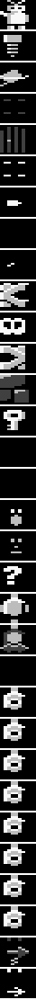

# Robbo Konstruktor (1990, L.K. Avalon) – reverse engineering

Level editor for [Robbo](../robbo). Analysis of the disk image
`bin/Robbo Konstruktor (1990)(L.K. Avalon)(PL).atr` (133,136 bytes), following
[DISASSEMBLY-GUIDE.md](../DISASSEMBLY-GUIDE.md). Process and findings: [NOTES.md](NOTES.md). What the program is
about, its users and a Polish–English glossary: [ABOUT.md](ABOUT.md).

Status: steps 1-4 of the guide done – the program is split into sources (`src/`, `main.asm`) that reassemble
**byte for byte** with MADS (12.5 KB of code found). Step 5 in progress: the game engine carries the **original
Robbo names** (110 routines, zero page) found by matching against `../robbo/d1/*.ASM`; the editor is next.

## Files

| File | Purpose |
|---|---|
| `bin/Robbo Konstruktor (1990)(L.K. Avalon)(PL).atr` | original disk image ("fast hack by Mr.Bacardi") |
| `game.bin` | 64 KB memory image at program start (boot loader + all segments) |
| [util/atr.py](util/atr.py) | ATR reader: header, boot record, used sectors, DOS 2-style sector chains |
| [util/image.py](util/image.py) | builds `game.bin` from the disk |
| [util/emu.py](util/emu.py) | 6502 emulator (from Jaskiniowiec) with an SIO hook serving disk sectors from the ATR |
| [util/planets.py](util/planets.py) | loads the saved planet sets by running the program's own loader in the emulator |
| [util/render.py](util/render.py) | renders the palette and planets the way the editor draws them (XFormer palette) |
| [util/split.py](util/split.py) | splits `game.bin` into `src/` and writes `main.asm`; tables `BLOCKS`, `ENTRIES` (+ dispatch tables), `NOFOLLOW`, `VARIABLES`, `COMMENTS`, `NAMES`, `POKES` |
| `util/xex.py`, `rdis.py`, `asm.py`, `verify.py` | from [../jaskiniowiec/util/](../jaskiniowiec/util/); `rdis.py` here also finds entries written into self-modified jumps and VBIs installed with SETVBV |
| `main.asm`, `src/` | generated sources (see below) |
| `Makefile` | `make` builds `bin/game.obx` with MADS, `make test` compares it with `game.bin` |

## Source blocks

| File | Address | Content |
|---|---|---|
| [src/JOINT.ASM](src/JOINT.ASM) | – | common labels (Atari OS/hardware, labels outside the blocks) |
| [src/RUNAD.DTA](src/RUNAD.DTA) | $02E0-$02E1 | RUNAD = $A810 |
| [src/HOOK.ASM](src/HOOK.ASM) | $0480-$0482 | restart hook: JMP $A810 |
| [src/BOOT.ASM](src/BOOT.ASM) | $0500-$067F | boot sectors 1-3: boot record and binary-file loader (cracked) |
| [src/EDIT08.ASM](src/EDIT08.ASM) | $0800-$0C6C | code: JMP $09A6 at $0800, tables, routines |
| [src/HELP.ASM](src/HELP.ASM) | $0C6D-$1DD0 | help text: 16 pages in Polish (HELP key) as `dta c'…'` strings with the decoded text in comments – see "Help text" below |
| [src/ENGINE1.ASM](src/ENGINE1.ASM) | $1E00-$23FC | game engine: jump table $1E00, display list, info-line texts, DLIs, main loop (Robbo R1 reworked) |
| [src/ENGINE2.ASM](src/ENGINE2.ASM) | $243D-$35A3 | game engine: board drawing (CHNMON), Robbo, object behaviour (table $31EF), VBI CVBL, input KEJO, sound |
| [src/ENGINE3.ASM](src/ENGINE3.ASM) | $35C0-$395C | title page of the saved Robbo game (also "test Robbo"): display list, texts, logo, planet sequence |
| [src/FONT3C.FNT](src/FONT3C.FNT) | $3C00-$3FFF | font (modified Robbo F.FNT) |
| [src/D4000.DTA](src/D4000.DTA) | $4000-$47FF | data |
| [src/FONT48.FNT](src/FONT48.FNT) | $4800-$4BFF | font (modified Robbo S.FNT) |
| [src/FONT4C.FNT](src/FONT4C.FNT) | $4C00-$4FFF | font (modified Robbo I.FNT) |
| [src/EDIT90.ASM](src/EDIT90.ASM) | $9000-$9430 | editor code |
| [src/EDITOR.ASM](src/EDITOR.ASM) | $94E0-$9F7A | editor: menu dispatch, cursor, commands |
| [src/TEXTS.ASM](src/TEXTS.ASM) | $9F7B-$A808 | editor tables (menu table $9F8E) and texts as strings: screens, messages, element names – see "Editor texts" below |
| [src/EDITOR2.ASM](src/EDITOR2.ASM) | $A810-$B5FF | editor: jump table $A810, main loop, screen, DLI, text input |
| [src/LOADSCR.ASM](src/LOADSCR.ASM) | $BC40-$BC67 | loading screen line, `dta d'  Robbo Konstruktor    (C) 1990 Avalon  '*` (screen codes, inverse) |

A first cut by segments; blocks will be regrouped into modules once the code is understood (step 6).

## Program structure (first look)

| Area | What |
|---|---|
| $A810 | jump table, 16 entries; start $A9A7, main loop $A9B5 (every 4 frames, OS timer 3) |
| $94E0-$9F7A | editor: menu dispatch (table $9F8E, menu words "kolory", "test", "planety", "strona"), cursor, commands |
| $9F7B-$A808 | editor texts |
| $A810-$B4F8 | editor: screen, DLI ($B05F), text input (key table $B330) |
| $1E00-$3919 | game engine (Robbo-based): jump table $1E00 / $1E03 (called by the menu's "test"), DLIs, object behaviour table $31EF (97 object codes) |
| $3C00-$4FFF | fonts (modified Robbo fonts) |

## How to regenerate

From this folder:

```powershell
py -3 util/atr.py "bin\Robbo Konstruktor (1990)(L.K. Avalon)(PL).atr"                      # disk info
py -3 util/atr.py "bin\Robbo Konstruktor (1990)(L.K. Avalon)(PL).atr" chain 4 konstruktor.xex  # the program file
py -3 ../jaskiniowiec/util/xex.py konstruktor.xex                                            # its segments
py -3 util/image.py "bin\Robbo Konstruktor (1990)(L.K. Avalon)(PL).atr" game.bin             # memory image
py -3 util/split.py game.bin                                                                 # sources
& $env:MADS main.asm -o:bin/game.obx                                                         # build
py -3 util/verify.py bin/game.obx                                                            # must match game.bin
```

`konstruktor.xex` is an intermediate (ignored by git, rebuilt from the disk).

## Disk structure

1,040 sectors × 128 bytes (enhanced density), 250 sectors used. **No DOS**: a boot disk with its own loader.

| Sectors | Content |
|---|---|
| 1-3 | boot record + loader, loaded to $0500 (boot record: 3 sectors, load $0500, init $19DD) |
| 4-222 | the program: one binary file (27,285 bytes) as a DOS 2-style sector chain |
| 360-361 | VTOC / "directory" – only text: "Robbo Konstruktor by L.K.Avalon --- fast hack by Mr.Bacardi" |
| 256, 260-264, 388, 392-396, 520, 524-532, 652, 784, 974, 989 | not in the program chain – probably saved boards (slots 132 sectors apart); not analysed yet |

## Boot loader ($0500-$067F)

A DOS 2-style binary loader without DOS: reads the sector chain from sector 4 (bytes 125-126 of each sector =
next sector, byte 127 = byte count) through SIOV, parses binary-file segments (skipping `$FFFF`), calls
INITAD after each segment and finally `jmp (RUNAD)` ($052E). Cracker patches: `NOP NOP NOP` at $052B and $05A3.

## Program segments (load order)

| # | Address | Content (first look) |
|---|---|---|
| 0 | $BC40-$BC67 | loading screen line at the OS screen: "Robbo Konstruktor (C) 1990 Avalon" (inverse) |
| 1 | $02E0-$02E1 | RUNAD = $A810 |
| 2 | $0480-$0482 | `JMP $A810` – restart hook |
| 3 | $94E0-$A808 | |
| 4 | $A810-$B5FF | jump table of 16 entries at $A810 (start = `JMP $A9A7`), display list at $A846 |
| 5 | $9000-$9430 | |
| 6 | $0800-$1DD0 | |
| 7 | $4000-$47FF | |
| 8 | $4C00-$4FFF | font, related to Robbo `I.FNT` |
| 9 | $35C0-$395C | |
| 10 | $1E00-$23FC | |
| 11 | $243D-$35A3 | contains code shared with Robbo (e.g. $338E = Robbo $30D4, 562 bytes) |
| 12 | $3C00-$3FFF | font, related to Robbo `F.FNT` |
| 13 | $4800-$4BFF | font, related to Robbo `S.FNT` |

No INIT segments, nothing packed: the loaded segments are the program's memory at start.

## Relation to Robbo

The repository has the original Robbo sources ([../robbo/](../robbo/)). Konstruktor reuses parts of them at
other addresses: three of Robbo's fonts in modified form ($3C00 ≈ `F.FNT`, $4800 ≈ `S.FNT`, $4C00 ≈ `I.FNT`)
and about 3.7 KB of identical code/data runs (longest: 721, 562, 257, 234 bytes). Where code matches, the
original label names from `robbo/d1/*.ASM` can be used.

## Help text ($0C77-$1DD0)

The program's manual, shown with the HELP key. Format: `$00 nn` starts page *nn* (the text before marker 1 is
page 0); a character with **bit 7 set is followed by a space** (simple compression); Polish letters use low codes:
they are typed as CONTROL + a, c, e, l, n, o, s, z (help page 8 lists them in that order), so `$01` ą, `$03` ć,
`$05` ę, `$0C` ł, `$0E` ń, `$0F` ó, `$13` ś, `$1A` ż – only one z, so ż and ź share it;
`$1C-$1F` = arrows ↑↓←→. Control codes for the viewer: **`$14` toggles inverse video** (titles), inverse digits
`$B1-$B9` = indentation.

| Page | Title | Function |
|---|---|---|
| 0-1 | – | introduction, HELP key, messages at the bottom of the screen, Avalon's address (P.O. box 702, Rzeszów) |
| 2 | Menu główne | main menu along the bottom of the screen |
| 3 | Test planety | test the current planet |
| 4 | Czyść planetę | clear the planet, restore its colours |
| 5 | Zmiana kolorów | change the planet's colours |
| 6 | Operacje (kasetowe/dyskowe) | save / load / delete a set of planets (tape or disk) |
| 7, 12 | Funkcje dodatkowe / podstawowe | switch between the additional and the basic functions |
| 8 | Strona tytułowa | edit the start and congratulation texts (CTRL + a,c,e,l,n,o,s,z = Polish letters) |
| 9 | Kolejność planet | order of the planets in the game |
| 10 | Test Robbo | test the whole game |
| 11 | Zapisz Robbo | save a stand-alone Robbo game to tape / disk |
| 13 | Zbiór elementów składowych planety | the element palette, in the right part of the screen |
| 14 | Edytor planety | put the selected element at the cursor (fire) |
| 15 | – | anti-piracy notice: a version with errors "is an illegal copy" |

## Editor texts ($9F7B-$A808)

Two encodings in one block (written as `dta d'…'` / `dta c'…'` strings in `src/TEXTS.ASM`):

| Range | Encoding | Content |
|---|---|---|
| $9F7B-$9FBA | – | tables: menu dispatch $9F8E (10 handlers), $9FA2 / $9FAC (10 bytes each), menu column offsets $9FB6 (20, 60, 100, 140, 180) |
| $9FBB-$A316 | screen code, `$00` = space; Polish letters on the glyphs `@ \ [ ] _ { ^ \|` (as in Robbo's TITLE.ASM) | editor screens: main menu (5 rows × 2 columns of 20: basic functions left, additional right), title "Robbo Konstruktor /1990 by Avalon", planet legend ("planety: – zła – dobra – pusta", "K:", "R:"), disk panel ("zawartość dysku", "pusty", "wczytaj", "zapisz", "skasuj", sets 01-05, "pełny"), save hints for disk and tape |
| $A317 | – | variable (used by $968F, $9CE4, $9D07, $9DAC) |
| $A318-$A7D5 | ATASCII, `$00`-terminated, bit 7 = inverse highlight, Polish letters as CONTROL codes | messages: key hints, errors ("błąd: brak robocika!", "…za dużo śrubek! – max: 99", "błąd numer 100!"), questions ("wyczyścić planetę? tak nie"), tape/disk messages, and the **names of the 27 palette elements** (Robbo, śrubka, kapsuła, skrzynka, drzwi, … nietoperz, działko, laser, blaster, teleportacja) |
| $A7D6 | – | variable (used by $9CDF, $9CE7, $9F52) |
| $A7D8-$A7F7 | ATASCII | four 8-character labels: " wczytać", " zapisać", "skasować", "kasetowe" |
| $A7F8-$A803 | – | two small tables (read at $9B57, $9B5C, $9B62) |
| $A804-$A808 | ATASCII | "Robbo" |

The menu text has a typo in the original: "funcje podstawowe" (for "funkcje").

## Editor structure

| Part | Routines |
|---|---|
| start, main loop | `START` → `START_` ($A9A7), `ED_SETUP`, `MAIN_LOOP` (every 4 frames: `REDRAW`, `ED_FRAME`, `EDIT`) |
| module interface ($A810) | `CLICK INPUT_CLR GETKEY REDRAW COUNT_ELEM INPUT DIR_TEST KEY_EVENT TO_DIGITS ASK_YESNO ATA2SCR SET_DLIST TITLE_ED WAIT_KEY` |
| editor services ($94E0) | `ED_FRAME ED_INIT ED_COLORS MESSAGE IO_MSG ELEM_MSG ED_DLIST HELP_KEY` |
| main menu | `MENU`: index = row + 5 × page; `M_TEST M_CLEAR M_COLORS M_DISK M_PAGE` (basic) / `TITLE_ED M_ORDER M_TESTALL M_SAVEGAME M_PAGE` (additional); `HELP_PAGE` = index / 2 + 3 (context help) |
| board editor | `EDIT`, `CELL_ADDR`, `AUTO_VARIANT`, `PLANET_TEST`, `PLANET_CLR`, `REDRAW_`, `PUT_CELL`, `BLINK` |
| help viewer | `HELP` / `HLP_*` |
| tape / disk | `IO_CMD` (letters r w e d), `IO_*`, `DISK_*` sub-menu, `IO_FORMAT` (zapisz Robbo) |
| text input | `TX_*` (title page texts) |
| engine entries | `ENGINE_INIT` ($1E00), `ENGINE_PLAY` ($1E03) |

## Engine structure

Robbo's engine (`../robbo/d1/R1.ASM`, `R2.ASM`), reworked to be called from the editor; names are Robbo's where the
routine corresponds (NOTES.md sections 5 and 14).

| Part | Routines |
|---|---|
| entries | `ENGINE_INIT` → `ENGINE_INIT_` (screen, board row tables $23FD / $241D for the board at $BE00, DLI1); `ENGINE_PLAY` → `ENGINE_PLAY_` (A = planet data page, X = number shown, Y = lives – $FF = one try, carry = demo; own VBI) |
| play loop | `PLA1` (start a planet: header, colours, players), `ENTCV` (draw it), `CHNGCV` (one turn: behaviour of every cell from table $31EF), `WYBC` + `WHIL` (Robbo destroyed: the planet explodes), `NXCV` (planet done), `PLAY_ABORT` / `PLAY_EXIT` (back to the caller: BREAK, game over) |
| screen | `CHNMON`: BREAK test, `FAC_STEP`, `ANIM` (animation phase of the shapes), `DRAW_ROW` (board → screen as 2 × 2 characters); `DLI1` → `DLI2` → `DLI3` (playfield / info line / blinking text); VBI `CVBL` (sound, info line via `INFO_BYTE` / `INFO_DIGIT`, scrolling `SCRL`) |
| Robbo | `MFAC` only notes the position; `FAC_STEP` → `FAC_TURN`: `TFAC` / `ZABJ` (creature next to Robbo), `MGNL` (magnet in the row), `FAC_MOVE` (move or shoot, `SJMP` via `KIET`) – Robbo's checks were moved from the creatures to Robbo |
| objects | Robbo's handlers by object code: `STWA`-`STWL` creatures, `TOPL` / `TOPR` shooting bats, `LEDZ` eyes, `DZ1x`-`DZ3x` guns, `POnx` / `PPnx` bullets, `BEZx` sliding boxes, `MGFL` / `MGFR` magnet pull, `TELP` / `TELE_IN` teleports, `WYZA` / `WYOT` capsule closed / open, `BOMB`, `NIES` surprise, `WFAC` Robbo appearing |
| input | `KEJO`: fire = joystick triggers, SHIFT, RETURN; stick = both joysticks AND cursor keys → `MOVE_IN`, `FIRE`; ESC → `ESC_KEY`; `GET_KEY` |
| title page ($35C0) | `TP_START` (saved game, or "test Robbo" with `TP_TEST` set), `TP_LOOP`, `TP_PAGE` (text page $3A00 start / $3B00 congratulation), `TP_LOGO`, `TP_FRAME`, `TP_KEY`, `TP_DEMO` (OPTION or a pause), `TP_PLAY` (planets in the order $39E0, 8 lives, restart point every 4 planets), `TP_EXIT` (BREAK back to the Konstruktor) |

Engine texts (screen codes, `dta d'…'`): info line $1E8E "BREAK: powrót do Robbo Konstruktora" (BREAK: back to
Robbo Konstruktor) and $1EB6 "Wciśnięcie strzału przerywa demonstrację" (pressing fire stops the demo); title page
$3603 "Ta gra powstała przy pomocy Robbo Konstruktora /1990 Avalon" (this game was made with Robbo Konstruktor,
(c) 1990 Avalon – `/` is probably the © glyph of the font) or, in "test Robbo", $3643 "wciśnij klawisz BREAK aby
wrócić do Robbo Konstruktora" (press BREAK to return to Robbo Konstruktor).

## Planet format and disk slots

- Planet n in memory at `$5000 + n × $200` (32 planets): 16 × 31 cells row by row, header (colours) at offset
  `$1F0-$1F7`; `$1F7` bytes are saved. Cells are Robbo's level characters: `$20` empty, `$2A` Robbo, `$14` capsule,
  `$24` screw, … `PLANET_STATE` ($39A0): 0 empty, bit 7 = bad (low bits = error message), else good.
- A test accepts a planet with exactly one Robbo, exactly one capsule and fewer than 100 screws.
- Disk: 5 slots for planet sets, header sectors **256, 388, 520, 652, 784** (slot 0 = sector 4 = the program);
  header signature inverse " RKdata " (used) or " unused " (erased). These are the extra used sectors of the disk.
- On this disk all five slots are **erased** (" unused "); slots 1-3 still hold old data – four tiny test boards
  (Robbo, a capsule, a few other cells). `util/planets.py` loads them by running the program's own loader in the
  emulator (`util/emu.py` with an SIO hook serving sectors from the ATR).

## Palette

`$B51C`, 32 entries; codes are Robbo's level characters. A cell is drawn as 2 × 2 characters from the board font at
`$4000` (top) / `$4400` (bottom), glyph = `$B55A[code − $20]` (NOTES.md section 12).

| # | Code | Element | # | Code | Element |
|---|---|---|---|---|---|
| 0 | `$2A` | Robbo | 11 | `$29` | magnes (magnet, second) |
| 1 | `$24` | śrubka (screw) | 12 | `$00` | murek (brick wall) |
| 2 | `$14` | kapsuła (capsule) | 13 | `$3D` | klucz (key) |
| 3 | `$23` | skrzynka (box) | 14 | `$13` | nicość (void) |
| 4 | `$12` | drzwi (door) | 15 | `$20` | gumka (eraser = empty cell) |
| 5 | `$06` | skrzynka na kółkach (box on wheels) | 16 | `$41` | stworek leworęczny (left-hand creature) |
| 6 | `$21` | amunicja (ammunition) | 17 | `$45` | stworek praworęczny (right-hand creature) |
| 7 | `$25` | gruz (rubble) | 18 | `$3F` | niespodzianka (surprise) |
| 8 | `$40` | bomba (bomb) | 19 | `$2E` | działko obrotowe (rotating gun) |
| 9 | `$28` | magnes (magnet) | 20 | `$0E` | działko ruchome (moving gun) |
| 10 | `$26` | oczy (eyes) | 21 | `$A0` | zmiana dział, nietoperzy i teleportacji – a mode switch, drawn empty |

Entries 22-29 are placeholders (`$78`, one glyph) for nietoperz strzelający, nietoperz, działko, laser, blaster,
teleportacja – their real codes depend on the switch (entry 21); entries 30-31: `$4E`, `$4A`.



Test boards from the erased disk slots:  
